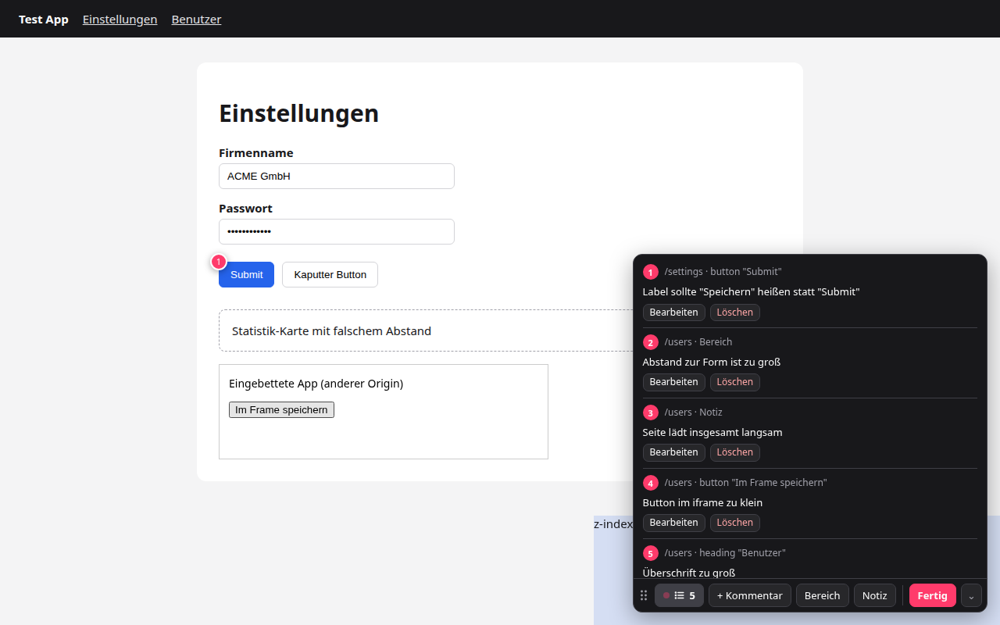

# Nitpick

UI-Feedback für Coding-Agents: durch die App klicken, Elemente oder Bereiche kommentieren und am Ende einen Export erzeugen, den ein Agent wie Claude Code oder Codex direkt abarbeiten kann. Der Export enthält Screenshots mit Markern, stabile Selektoren, Komponentennamen, die Klick-Timeline und Console-Errors.



Zwei Varianten mit demselben Kern:
- **Browser-Extension** (Chrome/Chromium, MV3) für die Entwicklung. Funktioniert auf jeder Website, nichts landet im Bundle der App.
- **Embed** zum Einbinden in die eigene App. Nutzer brauchen dann keine Extension, und das Ergebnis geht direkt in ein Feedback-Formular oder Ticket. Siehe [In-App-Variante](#in-app-variante-embed).

> Status: experimentell, nicht im Chrome Web Store. Installation aus dem Quellcode.

## Installation

Voraussetzungen: Node.js 22+ und pnpm.

```bash
git clone https://github.com/AlexRaudzus/nitpick.git
cd nitpick
pnpm install
pnpm build
```

Dann in Chrome `chrome://extensions` öffnen, den Entwicklermodus einschalten, **Entpackte Erweiterung laden** wählen und `.output/chrome-mv3` auswählen.

## Nutzung

1. **Klick aufs Extension-Icon** (oder `Alt+Shift+F`) startet eine Session. Bei laufender Session blendet derselbe Klick die Toolbar ein oder aus, eine beendete Session setzt er fort. Das Badge am Icon zeigt die Anzahl der Kommentare.
2. Ganz normal durch die App klicken. Zum Kommentieren **`Strg+Alt` gedrückt halten** (macOS: `⌘+⌥`) und ein Element anklicken. Nach dem Loslassen navigierst du wieder ganz normal. Solange die Tasten gedrückt sind, zeigt eine Leiste oben alle Kürzel.
3. Toolbar unten rechts:
   - **Listen-Symbol mit Anzahl** und **Notiz** – öffnen sich beim Hovern und schließen sich, sobald die Maus die Toolbar verlässt. Die Notiz gilt pro Seite und speichert sich selbst.
   - **+ Kommentar** – ein einzelnes Element kommentieren, ohne Tasten zu halten (auch `Alt+Shift+C`)
   - **Bereich** – ein Rechteck aufziehen und kommentieren
   - **⠿** – Toolbar verschieben, z. B. um Elemente dahinter auszuwählen. Die Position wird pro Website gemerkt, ein Doppelklick setzt sie zurück.
   - **⌄** – Toolbar ausblenden (Headless-Modus)
4. **Fertig** → **Exportieren** schreibt nach `~/Downloads/nitpick/<datum>_<uhrzeit>_<host>/` und legt den Ordnerpfad in die Zwischenablage. Über den Pfeil daneben lässt sich alternativ nur das Markdown kopieren.

Kommentare, Timeline und Console-Errors bleiben über Navigationen, Reloads und Login-Redirects auf andere Domains hinweg erhalten. Aufgezeichnet wird nur der Tab, in dem die Session läuft, und Tabs, die daraus geöffnet oder kommentiert werden. Elemente in iframes lassen sich ebenfalls auswählen, auch bei anderer Domain.

### Tastenkürzel

| Kürzel | Aktion |
|---|---|
| `Strg+Alt` halten + Klick | Element kommentieren (`↑` wählt das Elternelement) |
| `Strg+Alt+B` | Bereich markieren |
| `Strg+Alt+N` | Notiz zur Seite |
| `Strg+Alt+K` | Kommentarliste |
| `Strg+Alt+H` | Toolbar ein-/ausblenden |
| `Strg+Alt+E` | Exportieren |
| `Alt+Shift+F` | wie Klick aufs Icon (auch ohne Fokus auf der Seite) |
| `Alt+Shift+C` | ein Element kommentieren |
| `Alt+Shift+E` | Exportieren |

Die `Alt+Shift`-Kürzel sind Browser-Kürzel und unter `chrome://extensions/shortcuts` änderbar. Die `Strg+Alt`-Kürzel gelten nur auf der Seite.

Rechtsklick aufs Icon bietet: Exportieren, Toolbar ein-/ausblenden, Tastenkürzel anpassen.

### Headless-Modus

Mit `Strg+Alt+H` oder einem Klick aufs Icon verschwindet die Toolbar, die Session läuft weiter.
- Marker und die Kürzel-Leiste erscheinen nur, solange `Strg+Alt` gedrückt ist.
- Nach jedem Kommentar erscheint eine kurze Bestätigung.
- Der Modus bleibt auch für spätere Sessions eingestellt.

**Exportieren während einer laufenden Session** (`Strg+Alt+E`) schreibt den Ordner, kopiert den Pfad und startet sofort eine neue, leere Session. So bleibt die Extension dauerhaft scharf: kommentieren, exportieren, dem Agent übergeben, weiter kommentieren.

## Export

```
nitpick/2026-10-23_14-02-11_localhost_3000/
  feedback.md          ← primär für den Agent
  feedback.json        ← gleiche Daten strukturiert (format: nitpick/v1)
  screenshots/
    01-crop.png        ← Nahaufnahme des Elements bzw. Bereichs
    01-viewport.png    ← sichtbarer Bereich mit nummeriertem Marker
```

Pro Kommentar enthält `feedback.md`:
- die Seite und den Kommentartext
- Element-Identifikatoren:
  - Test-ID
  - Komponentenkette (React, Vue, Svelte)
  - CSS-Selektor: bevorzugt stabile Attribute wie `data-slot`, `name` oder `aria-label`, nie Utility-Klassen wie Tailwind oder generierte IDs
  - Accessible Name
  - umgebender Abschnitt
  - Position
  - gegebenenfalls das iframe, in dem das Element liegt
- die Screenshots
- die Schritte seit dem letzten Kommentar
- Console-Errors kurz davor
- den App-Kontext (siehe [Metadaten](#metadaten-von-der-website-optional))

Danach folgen die komplette Action-Timeline und alle Console-Errors und -Warnings, dedupliziert.

Übergabe an den Agent, z. B. in Claude Code:

> Arbeite das Feedback in ~/Downloads/nitpick/2026-10-23_14-02-11_localhost_3000/feedback.md ab. Schau dir zu jedem Punkt die Screenshots an.

### Datenschutz

- Passwort-, Token-, Karten- und ähnliche Felder werden in der Timeline als `••••` aufgezeichnet.
- JWTs, Bearer-Tokens und `password=…`-Muster in Logs werden geschwärzt.
- Network-Traffic wird bewusst nicht aufgezeichnet. Bei Bedarf lässt sich ein HAR aus den DevTools exportieren.
- Alles bleibt lokal: Es gibt keinen Server, die Daten liegen im Browser-Speicher, bis du exportierst oder verwirfst.

## Metadaten von der Website (optional)

Eine App kann zusätzlichen Kontext liefern, z. B. User-Rolle, Version, Tenant oder Feature-Flags. Dafür gibt es drei Varianten, die sich kombinieren lassen; spätere überschreiben frühere:

```html
<!-- 1. statisch -->
<meta name="nitpick:version" content="2.4.1">
```

```js
// 2. global (Objekt oder Funktion, darf async sein) – wird bei jedem Kommentar neu gelesen
window.__NITPICK__ = () => ({ userRole: currentUser.role, tenant: tenant.slug });

// 3. Event – praktisch aus Komponenten oder Stores heraus
window.addEventListener('nitpick:request-context', (e) => {
  e.detail.respond({ featureFlags: flags.enabled() });
});
```

Ohne installierte Extension passiert nichts. Der Code kann also auch in Production bleiben.

## In-App-Variante (Embed)

Für Apps, deren Nutzer keine Extension installieren sollen. Toolbar und Recorder sind dieselben wie in der Extension.

```bash
pnpm build:embed   # → dist/embed/{index,loader}.js + Typen; React ist peer dependency
```

Einbindung aus einem lokalen Klon, z. B. als `"nitpick": "link:../nitpick"`:

```ts
// App-Shell: winzig, ohne Abhängigkeiten
import { hasPendingSession, loadRecorder } from 'nitpick/embed/loader';

async function recorder() {
  const { createFeedbackRecorder } = await loadRecorder(); // lädt Toolbar + Recorder erst bei Bedarf
  return createFeedbackRecorder({
    context: () => ({ userRole: user.role, version: APP_VERSION }),
    onComplete: (result) => openFeedbackModal(result), // die Toolbar ist hier schon ausgeblendet
  });
}

// "Aufnehmen"-Button (muss ein Klick sein, wegen der Tab-Freigabe)
onRecordClick = async () => (await recorder()).start();

// Nach einem Reload läuft die Session weiter
if (hasPendingSession()) (await recorder()).restore();
```

`result` enthält:
- `markdown` und `json`
- `files` als `File[]`: `feedback.md`, `feedback.json` und `screenshots/NN-*.png`
- `session`
- `renderMarkdown({ assetUrl })`: Markdown mit eingebetteten Bildern, z. B. nachdem die Screenshots in ein Ticket hochgeladen wurden

Danach entscheidet die App:
- `recorder.clear()`, wenn das Feedback übernommen wurde
- `recorder.restore()` bei Abbruch, dann ist die Toolbar wieder da

Unterschiede zur Extension:
- **Screenshots** (`screenshots: 'auto' | 'tab' | 'dom'`):
  - `auto` fragt beim Start einmal nach der Tab-Freigabe (`getDisplayMedia`, pixelgenau).
  - Wird sie abgelehnt oder wurde die Seite neu geladen, wird das DOM nachgerendert (modern-screenshot). Dann können Cross-Origin-Bilder, Canvas und Video fehlen.
- **Speicher:** IndexedDB, übersteht Reloads. Mehrere Tabs synchronisieren sich über `BroadcastChannel`.
- **Nur eine Origin:** Login-Redirects auf eine andere Domain landen nicht in der Timeline, und Elemente in iframes lassen sich noch nicht auswählen.
- Zusätzlich zu den Metadaten-Quellen oben gibt es die `context`-Option.

Lokal ausprobieren: `pnpm dev:embed`, dann http://localhost:5180/settings öffnen (mit simuliertem Feedback-Modal).

## Entwicklung

```bash
pnpm dev             # Browser mit geladener Extension und Hot-Reload
pnpm typecheck
pnpm test            # Unit-Tests (Rendering, Element-Erkennung, Schwärzung, Session-Store)
pnpm build && pnpm e2e   # lädt die Extension in Playwright-Chromium und spielt eine Session durch
pnpm e2e:embed       # dieselbe Session in der In-App-Variante (Tab-Capture und DOM-Screenshots)
pnpm serve           # Test-Seite auf http://localhost:5179/settings für manuelles Testen
```

Aufbau:

| Pfad | Aufgabe |
|---|---|
| `core/host.ts` | `FeedbackHost`: Schnittstelle zwischen UI und Umgebung (Speicher, Screenshots, Seitenzugriff, Abschluss-Aktionen) |
| `core/session-store.ts` | Session-Logik über einem Key-Value-Backend |
| `core/ui/` | Toolbar, Picker, Composer (React), Recorder, Screenshot-Markierung |
| `core/page.ts` | Code für den Seitenkontext: Console, History, Framework-Komponenten, Metadaten |
| `core/render.ts` | Markdown- und JSON-Export |
| `core/describe-element.ts` | Selektor, Rolle, Name, XPath |
| `entrypoints/`, `extension/` | Extension: Service Worker (`storage.local`, `captureVisibleTab`, Downloads), Content Script, Seitenkontext-Bridge, iframe-Picker |
| `embed/` | In-App-Variante: IndexedDB, `getDisplayMedia`- und DOM-Screenshots, `createFeedbackRecorder` |

Das Icon (`assets/icon.png`) wurde mit Codex generiert, weitere Entwürfe liegen in `assets/icon-concepts/`. Die Größen in `public/icon/` sind daraus heruntergerechnet.

## Bekannte Grenzen

- Screenshots zeigen nur den sichtbaren Viewport. Das Element sollte beim Kommentieren also sichtbar sein.
- Modale mit hartem Focus-Trap (z. B. Radix Dialog) können dem Kommentarfeld den Fokus wegnehmen.
- Bereichskommentare und Marker sehen nicht in iframes hinein.
- React 19 liefert keine Source-Location mehr, daher gibt es dort nur Komponentennamen. In Production-Builds sind diese meist minifiziert und werden weggelassen. Vue und Svelte liefern in Dev-Builds die Datei.

## Roadmap

- Video: in der Extension per `tabCapture`, im Embed über den ohnehin offenen `getDisplayMedia`-Stream
- Beispiel-Integration: Aufnehmen-Button im Feedback-Formular einer App, Upload der Screenshots, ein Ticket pro Session

## Lizenz

[MIT](LICENSE)
